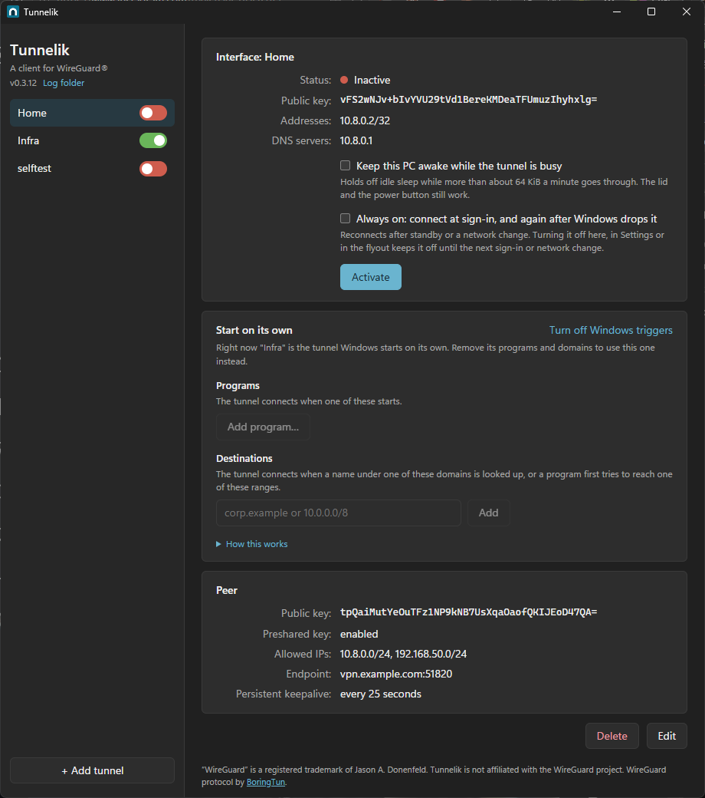
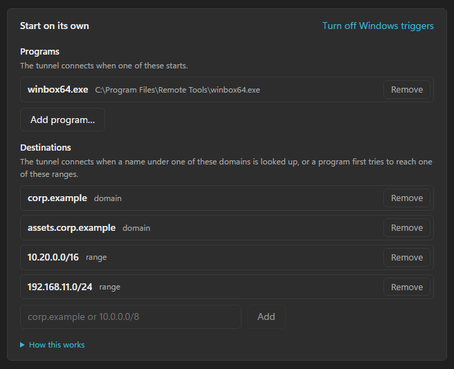

<div align="center">


# Tunnelik

**WireGuard tunnels in Windows 11's own VPN settings.**

Add a tunnel once, from the same `.conf` the official apps use.<br>
From then on it is just another VPN to Windows.

[](https://github.com/RasmusKoit/tunnelik/releases/latest) [](https://github.com/RasmusKoit/tunnelik/releases) [](#license) [](https://www.rust-lang.org/) [](#install) [](https://github.com/RasmusKoit/tunnelik/actions/workflows/ci.yml)

[Install](#install) · [Use](#use) · [How it works](#how-it-works) · [Build](#build) · [License](#license)

<br>



</div>

> Tunnelik is an independent project, not affiliated with or endorsed by the WireGuard project.
> See [Trademarks](#trademarks).

## Why Tunnelik?

Windows 11 already has a VPN page, a switch in the network flyout, and a place for profiles.
Tunnelik plugs WireGuard into all of that instead of adding a tray icon and a service of its
own. Toggle a tunnel from **Settings → Network & internet → VPN**, the taskbar flyout, the
Tunnelik window, or `tunnelik up <name>`. The official WireGuard app is not needed.

<table>
<tr>
<td width="33%" valign="top">

### 🪟 Native toggle
Connect and disconnect wherever Windows shows VPNs, including the network flyout in the taskbar.

</td>
<td width="33%" valign="top">

### 📄 Standard configs
Paste or import a `wg-quick` style `.conf`, with one or several peers. Nothing to convert.

</td>
<td width="33%" valign="top">

### 🔐 Secrets stay put
Configs are encrypted with DPAPI for your Windows user. The overview never shows a private key.

</td>
</tr>
<tr>
<td width="33%" valign="top">

### 🔁 Stays up
Rekeys on schedule and reconnects by itself within seconds when you switch networks. Per tunnel: **always on**, so it comes back after standby and at sign-in; **keep the PC awake** while it is busy; or **start on its own** for a program, a domain or an address range.

</td>
<td width="33%" valign="top">

### 📊 Live view
Latest handshake and bytes transferred per peer, right in the window.

</td>
<td width="33%" valign="top">

### 🖥️ Window and command line
The same tunnels, managed from either. Scripts and humans get the same features.

</td>
</tr>
</table>

## Install

**1.** Grab `Tunnelik-<version>-x64.msix` and `Tunnelik.cer` from the
[latest release](https://github.com/RasmusKoit/tunnelik/releases/latest).

**2.** Trust the certificate once. The package is signed with a self-signed certificate, so from
an **administrator** PowerShell:

```powershell
Import-Certificate -FilePath .\Tunnelik.cer -CertStoreLocation Cert:\LocalMachine\TrustedPeople
```

**3.** Double-click the `.msix` and approve the administrator prompt (the package carries a
service, see [Starting on its own](#starting-on-its-own)), or from an **administrator**
PowerShell:

```powershell
Add-AppxPackage .\Tunnelik-<version>-x64.msix
```

Later versions install over it as updates.

> [!NOTE]
> **Coming from 0.2.x?** Those packages were named `RasmusKoit.Tunnelik`; 0.3 is `dev.koit.Tunnelik`,
> a different package to Windows, so it installs next to the old one rather than over it. To move
> your tunnels: copy `%LOCALAPPDATA%\Packages\RasmusKoit.Tunnelik_<id>\LocalState\tunnels` somewhere
> safe, remove the old package (`Get-AppxPackage RasmusKoit.Tunnelik | Remove-AppxPackage`) and its
> VPN profiles (`Get-VpnConnection` and `Remove-VpnConnection` for each tunnel), install 0.3 and open it
> once, copy the `tunnels` folder into `%LOCALAPPDATA%\Packages\dev.koit.Tunnelik_<id>\LocalState`, and
> run `tunnelik repair`. The configs are encrypted for your Windows user, not for the package, so they
> carry over as they are.

## Use

Open **Tunnelik** from the Start menu, click **Add tunnel**, paste or import a config, and
**Save**. The tunnel now appears in Settings → VPN like any other; the switch next to its name in
Tunnelik does the same thing. Starting from scratch? **Generate key** puts a fresh private key
into the config and shows the public key to give the server side.

The same from a terminal:

| Command | Does |
|---|---|
| `tunnelik` | Opens the window |
| `tunnelik add <name> <file.conf>` | Adds a tunnel, or replaces its config |
| `tunnelik up <name>` / `tunnelik down <name>` | Connects / disconnects |
| `tunnelik list` | Lists tunnels and their state |
| `tunnelik always-on <name> on\|off` | Brings it back after Windows drops it, and at sign-in (see below) |
| `tunnelik keep-awake <name> on\|off` | Keeps the PC awake while the tunnel is busy (see below) |
| `tunnelik trigger <name> app <path.exe>` / `dns <suffix>` | Starts the tunnel when that program runs, or a name under that domain is looked up |
| `tunnelik trigger <name> subnet <cidr>` | Starts the tunnel when a program first tries to reach an address in that range (Tunnelik's own watcher) |
| `tunnelik trigger <name>` / `tunnelik trigger <name> remove <value>` | Lists or removes those |
| `tunnelik trigger enable\|disable` | Turns "start on its own" on or off (administrator approval) |
| `tunnelik remove <name>` | Removes a tunnel and its VPN profile |
| `tunnelik repair` | Recreates VPN profiles Windows dropped (see below) |

> [!NOTE]
> Windows runs **one connection per VPN plugin**, so connecting a tunnel disconnects any other
> Tunnelik tunnel.

### Always on

A laptop left alone goes into Modern Standby on its idle timer, and some minutes into standby
Windows hangs up every VPN, Tunnelik's included, and never redials a plugin's. Tick **Always on**
on a tunnel (or run `tunnelik always-on <name> on`) and Tunnelik brings it back: a small
background task that Windows runs when the network changes, when you sign in and when you come
back to the PC dials the tunnel again if it is down, and shows a toast when it did. It behaves
like Windows' own always-on VPNs: turning the tunnel off yourself, in Tunnelik, Settings or the
flyout, keeps it off until the next sign-in or network change, and a tunnel dropped less than two
minutes ago is left alone. `tunnelik always-on <name>` shows the task's registrations.

### Starting on its own

Windows can also bring a tunnel up when you need it rather than keep it up: the **Start on its
own** card lists programs and DNS domains that dial the tunnel. Add Remote Desktop, say, and the
tunnel connects when you launch it; add `corp.example` and looking up any name under it connects
the tunnel first. Programs and domains are Windows' own VPN triggers; address ranges are
watched by Tunnelik itself, see [Subnets](#subnets) below.



This one is **off until you turn it on**, because it touches the system: Windows only watches
for a program or a name on behalf of a profile it was handed through its device-management
channel, which only the SYSTEM account can reach. Tunnelik ships a small service, `TunnelikMdm`,
that does that one job for Tunnelik's own package and nothing else; it is installed stopped.
**Turn on…** in the card (or `tunnelik trigger enable`) starts it, with Windows' administrator
prompt, and **Turn off** stops it; a restart stops it too, which only matters when the lists
change, since Windows itself does the dialing. The tunnel that starts on its own gets a
managed, machine-wide profile: Settings still shows it, but marks it as managed, and every
account on the PC sees it. Windows watches for one such profile, so one tunnel at a time can
start on its own. Changing its list rebuilds the connection, reconnecting it afterwards if it
was up, and for such a tunnel Windows does the always-on job itself.

Three Windows rules to know. After you disconnect such a tunnel yourself, Windows waits for the
next network change or sign-in before starting it again. The request that triggers it runs
before the tunnel is up, so the first one may fail; Tunnelik shows a toast when the tunnel is
up. And names under a trigger domain are resolved through the tunnel's DNS servers (the
`DNS =` line of the config), which keeps internal names working; a browser with its own secure
DNS never reaches the Windows resolver and so never triggers anything.

### Subnets

Windows has no trigger for an address range, so that one is Tunnelik's own. Add `10.0.0.0/8`
under **Destinations** in the Start on its own card, next to the domains (or
`tunnelik trigger <name> subnet 10.0.0.0/8`), and a small watcher, `tunnelik_watch.exe`, reads the system's TCP table once a second for
connections a program is trying to open into that range and dials the tunnel for the first one.
The tunnel is up a second or two later; the attempt that triggered it still fails, since Windows
keeps that connection on the route it chose, and the program's next try goes through. A toast
says which program reached what. It sees TCP only: `ping` and UDP leave nothing to see. After you
disconnect the tunnel yourself it stays down for ten minutes, and a tunnel Windows or the
flyout just dropped is left alone for two, like always-on does. Nothing needs turning on and
the profile stays an ordinary one. Windows starts the watcher at sign-in (Settings > Apps >
Startup lists it as Tunnelik, where it can be switched off); it exits by itself when no tunnel
has a subnet, and the window or the command starts it again when one is added.

### Keeping the PC awake

If a transfer must survive the night rather than resume after it, tick **Keep this PC awake while
the tunnel is busy** (or run `tunnelik keep-awake <name> on`) and the plugin holds a
system-required power request whenever more than about 64 KiB a minute goes through the tunnel,
the same thing a media player does while it plays. The screen still turns off and the lock screen
still comes on; only the step into sleep waits until the tunnel has been quiet for a minute.
Closing the lid and the power button work as before. The option is per tunnel, takes effect
within seconds, and `powercfg /requests` (from an administrator prompt) lists the request while
it is held.

<details>
<summary><b>Good to know</b></summary>
<br>

- When you **switch networks**, the tunnel comes back on its own, but Windows recreates the VPN
  interface to do it, which cuts connections that were open through the tunnel (SSH, rsync,
  downloads). Pings and new connections carry on.
- Windows **may drop or orphan a plugin's VPN profiles** when the package is uninstalled or
  renamed. The configs survive; `tunnelik repair` (which the window also runs when it opens)
  brings the profiles back, and a profile left pointing at an old package has to be removed
  first with `Remove-VpnConnection`.
- Tunnelik's profiles are ordinary entries in your **own phonebook**, so `Get-VpnConnection`
  and `rasdial` see them too. Windows' VPN management API could keep them in a phonebook of the
  package's own instead, but nothing in Windows' UI lists that one, so Tunnelik only uses that
  API to dial.
- `PreUp`/`PostUp` scripts and `Table = off` are refused rather than ignored; everything else in
  a `wg-quick` config is understood.
- The plugin logs to `%LOCALAPPDATA%\Packages\dev.koit.Tunnelik_<id>\LocalState\plugin.log`,
  which **Log folder** in the window's sidebar opens. Past 1 MiB the log moves aside as
  `plugin.log.1`, so at most 2 MiB stays on disk.
- Per-tunnel options such as keep-awake live in plain text next to the encrypted config, as
  `tunnels\<name>.options` in that same folder.

</details>

## How it works

Windows lets a packaged app provide a VPN through `IVpnPlugIn`: Windows owns the VPN interface,
routes and DNS, and hands the plugin packets to encrypt and datagrams to decrypt. Tunnelik's
plugin does exactly that, with [BoringTun](https://github.com/cloudflare/boringtun) speaking the
WireGuard protocol and a timer thread for handshakes and keepalives.

```
 Settings / flyout / window / CLI
               │  toggle
               ▼
   Windows VPN platform  ──  owns the interface, routes and DNS
               │  IVpnPlugIn
               ▼
   tunnelik_host.exe  ──  Tunnelik plugin  ──  BoringTun (WireGuard protocol)
               │
               ▼
     encrypted tunnel store  (DPAPI, per Windows user)
```

A VPN profile in Windows holds nothing but the tunnel's name. The config itself lives, encrypted,
in the package's data folder, where only the same Windows user can read it. Always on is a second
background task in the same DLL, `Tunnelik.TriggerTask`, which the window or the command
registers with Windows and which redials through the VPN management API.

<details>
<summary><b>Repository layout</b></summary>
<br>

| Path | What |
|---|---|
| `crates/wgconf` | Parser for WireGuard `.conf` files |
| `crates/plugin` | The VPN plugin: WireGuard sessions, Windows glue, the encrypted tunnel store |
| `crates/host` | `tunnelik_host.exe`, the process Windows starts the plugin in |
| `crates/manage` | Adding, removing and connecting tunnels, shared by the window and the command |
| `crates/app` | The window (Tauri, plain HTML/JS) |
| `crates/cli` | The `tunnelik` command |
| `crates/service` | `tunnelik_svc.exe`, the `TunnelikMdm` service that hands Windows the profile it starts on its own |
| `crates/watch` | `tunnelik_watch.exe`, the watcher behind subnet triggers |
| `package` | MSIX manifest and icons |
| `scripts` | Build, sign and install |

</details>

## Build

Rust and the MSVC build tools:

```powershell
winget install --id Microsoft.VisualStudio.2022.BuildTools --override "--add Microsoft.VisualStudio.Workload.VCTools --includeRecommended --passive"
winget install --id Rustlang.Rustup
```

Then:

```powershell
cargo test
.\scripts\package.ps1
```

`package.ps1` builds `target\Tunnelik-<version>-x64.msix` and signs it. On first use
`scripts\new-cert.ps1` creates the self-signed certificate (its private key stays in your user
certificate store) and exports `target\Tunnelik.cer`, which is what other machines trust. Bump
the version in `package\AppxManifest.xml` for each release so it installs as an update.

<details>
<summary><b>Faster iteration with a development install</b></summary>
<br>

`.\scripts\install-dev.ps1` registers the build straight from `target\appx` without signing; it
needs **Settings → System → For developers → Developer Mode**.

> [!IMPORTANT]
> A development install and the signed package can't replace each other: remove one with
> `Remove-AppxPackage -PreserveApplicationData` before installing the other, then run
> `tunnelik repair`.

</details>

## Contributing

Issues and pull requests are welcome. `cargo test` runs the test suite; the
[Build](#build) section covers producing an installable package.

## License

Tunnelik is licensed under either of

- Apache License, Version 2.0 ([LICENSE-APACHE](LICENSE-APACHE))
- MIT license ([LICENSE-MIT](LICENSE-MIT))

at your option.

Unless you explicitly state otherwise, any contribution intentionally submitted for inclusion in
Tunnelik by you, as defined in the Apache-2.0 license, shall be dual licensed as above, without
any additional terms or conditions.

## Acknowledgements

Tunnelik builds on the work of others:

- **[WireGuard®](https://www.wireguard.com/)** by Jason A. Donenfeld: the protocol Tunnelik
  speaks, and the `.conf` format it reads.
- **[BoringTun](https://github.com/cloudflare/boringtun)** by Cloudflare (BSD-3-Clause): the
  WireGuard protocol implementation used for handshakes and encryption.
- **[windows-rs](https://github.com/microsoft/windows-rs)** by Microsoft (MIT or Apache-2.0):
  Rust bindings for the Windows APIs.
- **[UwpVpnPluginSample](https://github.com/microsoft/UwpVpnPluginSample)** by Microsoft (MIT):
  showed how a VPN plugin package is laid out.
- **[WSSHVpnPlugin](https://github.com/poizan42/WSSHVpnPlugin)** by poizan42: its notes on the
  Windows VPN platform's undocumented behaviour (IPv6 requirement, start and stop deadlocks,
  plugin instance reuse) saved a lot of debugging. No code was copied.

The licenses of all third-party crates are listed in [THIRD_PARTY_NOTICES.md](THIRD_PARTY_NOTICES.md).

## Trademarks

"WireGuard" and the "WireGuard" logo are registered trademarks of Jason A. Donenfeld.
Tunnelik uses the name only to describe what it is compatible with.

<div align="center">
<br>

If Tunnelik saved you a tray icon, a ⭐ on the repo helps others find it.

</div>
